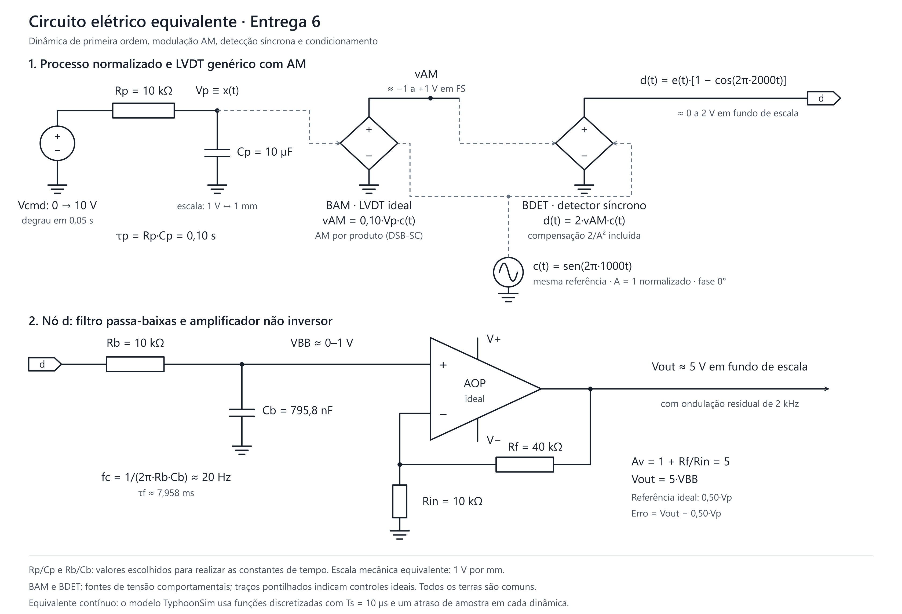

# TyphoonSim - Dinâmica, modulação AM e condicionamento

## Arquivos e ambiente

Abra [modelo.tse](modelo.tse) no Schematic Editor do **TyphoonSim 2026.3**.
O esquema usa o formato **4.2**, está configurado para **VHIL+** e mantém o
nome interno `ECOM060_G01_Entrega02_degrau`.
O [relatório](../relatorio/relatorio.pdf) apresenta o ensaio em degrau da
segunda etapa da cadeia de instrumentação, organizada aqui como entrega 6.

## Topologia

```text
Comando em degrau -> Processo de 1a ordem -> Sensibilidade + offset
                                                 |
                                            Modulador AM
                                                 |
Portadora de 1 kHz -> modulação e demodulação síncrona
                                                 |
                                    Compensação 2/A² -> Filtro
                                                 |
                                      Ganho não inversor -> Vout

Posição após o processo -> ganho 0,50 V/mm -> Videal
Erro = Vout - Videal
```

| Bloco | Configuração no modelo |
|---|---|
| Comando_Deslocamento_mm | Degrau de 0 a 10 mm em 0,05 s |
| Processo_1aOrdem_tau_100ms | Constante de tempo de 0,10 s |
| Referencia_Ideal_V_por_mm | Ganho de 0,50 V/mm, aplicado à posição após a dinâmica |
| LVDT_Ks_Adotado | Sensibilidade de 0,10 V/mm |
| Desvio_Zero_Sensor | Offset de 0 V |
| Portadora_Excitacao | Amplitude normalizada 1; frequência 1 kHz; fase 0°; offset 0 |
| Modulador_AM | Produto da envoltória do sensor pela portadora |
| Demodulador_Sincrono | Produto do sinal AM pela mesma portadora |
| Compensacao_2_sobre_A2 | Ganho 2, pois A = 1 |
| Filtro_Demod_1aOrdem | Passa-baixas de 1ª ordem, corte de 20 Hz |
| NaoInversor_1_mais_Rf_sobre_Rin | Ganho 5; referência de projeto: Rin = 10 kΩ e Rf = 40 kΩ |
| Erro_Dinamico_V | Subtração `Vout_Condicionada - Vout_Ideal` |

O processo é uma dinâmica normalizada de primeira ordem. O LVDT é representado
por sensibilidade e modulação por produto, com hipóteses didáticas de faixa e
portadora. As duas dinâmicas são discretas; o ganho final é um bloco ideal.

## Expressões e discretização

```text
Gp(s) = 1 / (0.10*s + 1)
e(t) = 0.10*x(t)
c(t) = sin(2*pi*1000*t)
vAM(t) = e(t)*c(t)                         [AM DSB-SC]
d(t) = 2*vAM(t)*c(t) = e(t)*(1-cos(2*pi*2000*t))
Gf(s) = 1 / (tau_f*s + 1), tau_f = 1/(2*pi*20)
Vout(t) = 5*saida_do_filtro(t)
Videal(t) = 0.50*x(t)
```

Todos os blocos de processamento e as sondas têm período de execução
`Ts = 1e-5 s` (10 µs). Para cada dinâmica, a discretização ZOH gravada é
`H(z) = (1-a)/(z-a)`, com `a = exp(-Ts/tau)` e um atraso de uma amostra.

| Dinâmica | Numerador b | Denominador a |
|---|---|---|
| Processo | `[9.999500016666385e-05]` | `[1.0, -0.9999000049998333]` |
| Filtro | `[0.001255847823713574]` | `[1.0, -0.9987441521762864]` |

## Configuração para reproduzir o relatório

O PDF e o comentário interno do modelo indicam duração de **1,5 s** e
amostragem de **10 µs**. Os campos de configuração do arquivo recebido mantêm
outros valores. Antes de executar o ensaio completo, ajuste em Model Settings:

| Campo | Gravado no arquivo recebido | Usar no ensaio do relatório |
|---|---|---|
| Simulation time / Stop time | 1,0 s | 1,5 s |
| Maximum simulation step | 1e-4 s (100 µs) | 1e-5 s (10 µs) |
| Data sampling rate | 0 | 1e-5 s (10 µs) |

O solver gravado é DAE/BDF, com passo inicial de 1 µs e tolerâncias absoluta e
relativa de 0,001. A simulação usa método `exact` e passo automático na
configuração de HIL. O `.tse` entregue foi preservado durante a reorganização.

## Execução e ensaios

1. Abra `modelo.tse`, confira os blocos e ajuste os campos da tabela acima.
2. Inicie a simulação no TyphoonSim. Caso utilize VHIL, compile e carregue
   o modelo nesse ambiente antes da execução.
3. Abra `Scope_G01` e selecione as sondas na janela **Signals**. O arquivo
   recebido não contém uma lista de sinais selecionados.
4. Observe os seguintes pares e intervalos:

| Ensaio | Sinais | Janela sugerida |
|---|---|---|
| Resposta completa | Vout_Ideal; Vout_Condicionada | 0 a 1,5 s |
| Transitório | Vout_Ideal; Vout_Condicionada | 0,04 a 0,50 s |
| AM | Envoltoria_Sensor_V; Sinal_AM | 0,800 a 0,805 s |
| Recuperação da banda base | Demod_Antes_Filtro_V; Demod_Depois_Filtro_V | 0,800 a 0,805 s |
| Fundo de escala | Vout_Ideal; Vout_Condicionada | 1,47 a 1,50 s |
| Erro | Erro_Vout_menos_Ideal_V | Transitório e trecho final |

No regime permanente, a envoltória tende a 1 V, o sinal AM oscila entre cerca
de -1 e +1 V e o sinal compensado antes do filtro entre cerca de 0 e 2 V.
O filtro recupera a banda base próxima de 1 V, com ondulação residual, e o
ganho final produz saída próxima de 5 V. A referência ideal já contém a
dinâmica do processo; a diferença transitória também inclui o atraso do filtro.

Em fundo de escala assentado, confira a saída na janela de **4,90 a 5,10 V**,
equivalente a ±2% de 5 V. Os extremos de aproximadamente 4,95 e 5,05 V são os
informados no relatório; não foram medidos novamente nesta reorganização.
Para quantificar o ensaio, exporte o trecho final para um CSV dentro desta
entrega e calcule os extremos e `100*max(abs(Vout-5))/5`.

## Circuito elétrico equivalente



[Versão vetorial SVG](../relatorio/figuras/circuito-equivalente.svg).

O desenho representa um equivalente **comportamental contínuo**. O processo
é realizado por `Rp = 10 kΩ` e `Cp = 10 µF`, com escala de 1 V por mm e
constante de tempo de 0,10 s. As fontes controladas BAM e BDET representam
a modulação e a demodulação síncrona com compensação, usando a mesma portadora
normalizada. O filtro usa `Rb = 10 kΩ` e `Cb = 795,8 nF`, resultando em corte
de aproximadamente 20 Hz; o amplificador não inversor usa Rin = 10 kΩ e
Rf = 40 kΩ, com ganho 5.

Os pares RC foram escolhidos para desenhar as constantes de tempo do modelo;
não são componentes físicos simulados no `.tse`. As fontes comportamentais
têm entradas de controle de impedância infinita e representam as operações
matemáticas. O desenho é o equivalente contínuo das funções discretizadas,
sem os atrasos de uma amostra da implementação digital.

Os parâmetros foram conferidos no modelo e no relatório. A simulação não foi
executada durante esta organização. Arquivos de compilação, executáveis,
caches e backups permanecem fora do versionamento.
