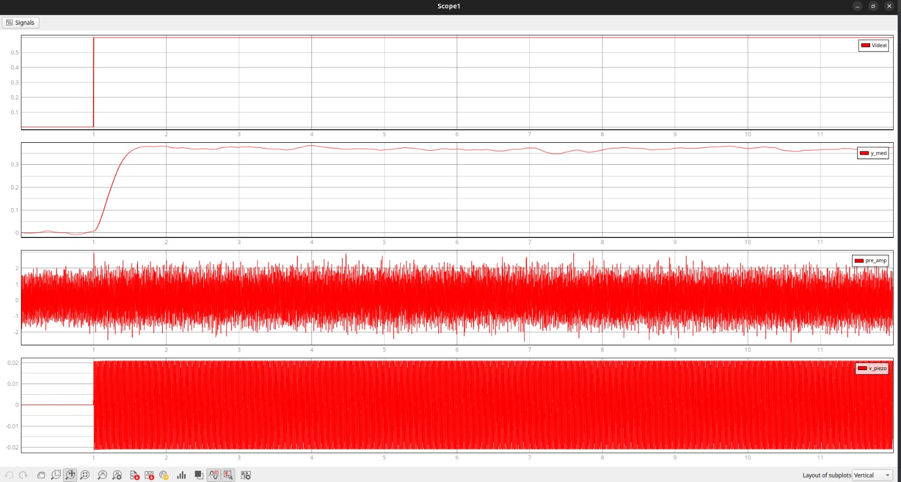

# Validação funcional da cadeia piezo + lock-in — instruções do modelo TyphoonSim

ECOM060 Instrumentação Eletrônica · UFAL · 2026.2 · Grupo 02 · Fase 1, Entrega 03 (vídeo)

A cadeia completa das Entregas 01 e 02 da Fase 1, **usada como estava**, com um gerador dos três ensaios-padrão e o
painel SCADA. Força em N rms → modulação a 100 Hz → piezo (camada estática + Thévenin Ct–Rin) → ruído e
interferências → pré-amp G = 25 → demodulação síncrona → Butterworth de 1 Hz → K = 1 V/N.

## Blocos

| Bloco | Função | Valores |
|---|---|---|
| `gerador_ensaios` | (a) degrau, (b) condição inicial, (c) pulso; evento em t = 1 s após **DISPARAR** | amplitude A (SCADA) |
| `portadora_chopper` | √2·sin(2π·100·t) | chopagem liga/desliga |
| `sensor_piezo` | S real, limiar, resolução | 24,6 mV/N; 0,02 N; 0,01 N |
| `Vs_piezo`, `Ct_piezo`, `Rin_preamp` | Thévenin do piezo (passa-alta) | 10 nF, 10 MΩ, τ = 0,1 s |
| `ruido_branco`, `interferencia` | camada espectral | σ = 20 mV; 3 mV; 5 mV a 0,05 Hz; 60 Hz de 20 mV |
| `condicionamento_lockin` | pré-amp + lock-in | G = 25, fc = 1 Hz |
| `processamento_compensacao` | escala K = 1/(S_nom·G) = 1; calibração de 1 ponto (×1,625) | — |

Código externo: só os blocos C function do próprio `.tse` (descrição em `codigo/README.md`).

## Roteiro de reprodução

1. Abrir `modelo.tse` no TyphoonSim 2026.2 (VHIL+, passo máximo 1e-4 s), compilar e carregar.
2. Abrir `painel.cus` no HIL SCADA e iniciar a simulação.
3. Ensaio = (a), Amplitude = 0,6, **DISPARAR**. Esperado: `y_med` sobe a 0,37 N (0,60 N com a calibração ligada),
   ≈ 0,3 s atrás de `Videal`.
4. Ensaio = (b): `y_med` decai a zero em ≈ 1 s depois de t = 1 s.
5. Ensaio = (c): pulso de 0,9 N por 0,5 s, atenuado e atrasado na saída.
6. Previsão e teste: Amplitude = 1,0 → previsto 0,615 N sem calibração (obtido no gêmeo: 0,619 N).
7. Camada a camada: chaves do painel (estática = sensibilidade + limiar + resolução; dinâmica = chopagem em
   "desligado"; espectral = ruído + offset/deriva/60 Hz).

## Captura de tela

