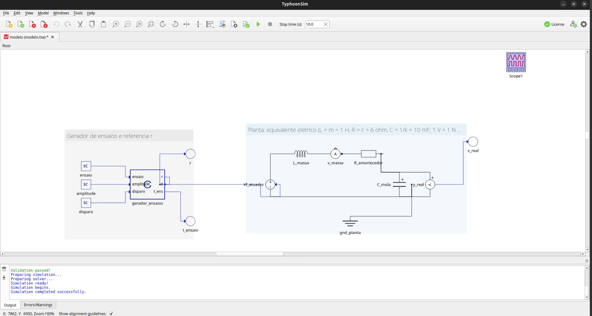
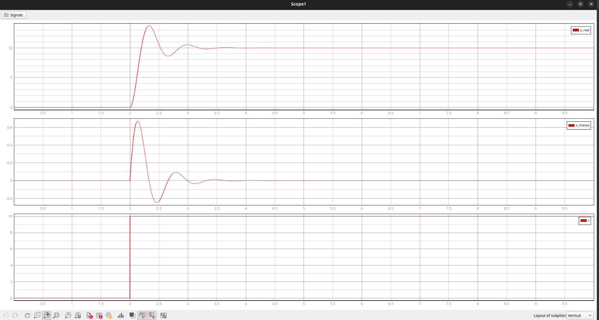

# Equivalente elétrico — instruções do modelo TyphoonSim (roteiro de repetibilidade)

ECOM060 Instrumentação Eletrônica · UFAL · 2026.2 · Grupo 02 (massa-mola-amortecedor) · Fase 2, Entrega 02

## Topologia

```
gerador_ensaios ─ r ─► Vf_atuador (+) ─ L_massa ─ v_massa (A) ─ R_amortecedor ─┬─ C_mola ─┬─ gnd
                                (−) ────────────────────────────────────────────┴─ y_real ─┘
```

Malha série única. Analogia força–tensão: m ↔ L, c ↔ R, k ↔ 1/C, x ↔ q, ẋ ↔ i, F ↔ v.
`y_real` = v_C = q/C = k·x (1 V = 1 N = 1 cm). `v_massa` = i = ẋ (1 A = 1 m/s).

## Valores

| Elemento | Análogo | Valor |
|---|---|---|
| `L_massa` | m | 1 H |
| `R_amortecedor` | c | 6 Ω |
| `C_mola` | 1/k | 10 mF |
| `Vf_atuador` | F | sinal do `gerador_ensaios` [V = N] |
| simulação | — | VHIL+, método exato, passo máximo 1e-4 s |

O único bloco não nativo é o `gerador_ensaios` (C function), que reinicia o relógio a cada disparo do SCADA.
O código está em `codigo/README.md`.

## Roteiro

1. Abrir `modelo.tse` no TyphoonSim 2026.2 e conferir *Model Settings*: VHIL+, passo máximo 1e-4 s.
2. *Compile* → *Load to VHIL*; abrir `painel.cus` no HIL SCADA; iniciar a simulação.
3. **Ensaio (a) degrau:** combo Ensaio = (a), Amplitude = 10, **DISPARAR**. Esperado: pico de 13,72 V (cm)
   0,329 s após o evento (t = 2 s), valor final de 10 V.
4. **Ensaio (b) condição inicial:** Ensaio = (b). A massa é segurada em 10 cm por 2 s e solta. Esperado: picos
   positivos separados por Td = 0,659 s; decremento logarítmico δ = 1,976 → ζ = 0,300.
5. **Ensaio (c) pulso:** Ensaio = (c). Regime em 10 V e pulso de 15 V entre 2,0 e 2,5 s. Esperado: pico de 16,87 V
   e retorno a 10 V.
6. **R4 (sensibilidade):** editar `R_amortecedor` (2, 12, 30 Ω), `L_massa` (0,25, 2, 8 H) ou `C_mola` (40, 20,
   5 mF), recompilar e repetir o passo 3. Esperado: com C = 40 mF, x = q = C·v_C = 40 cm, mas v_C continua 10 V
   (a tensão mede a força na mola).

## Capturas de tela




