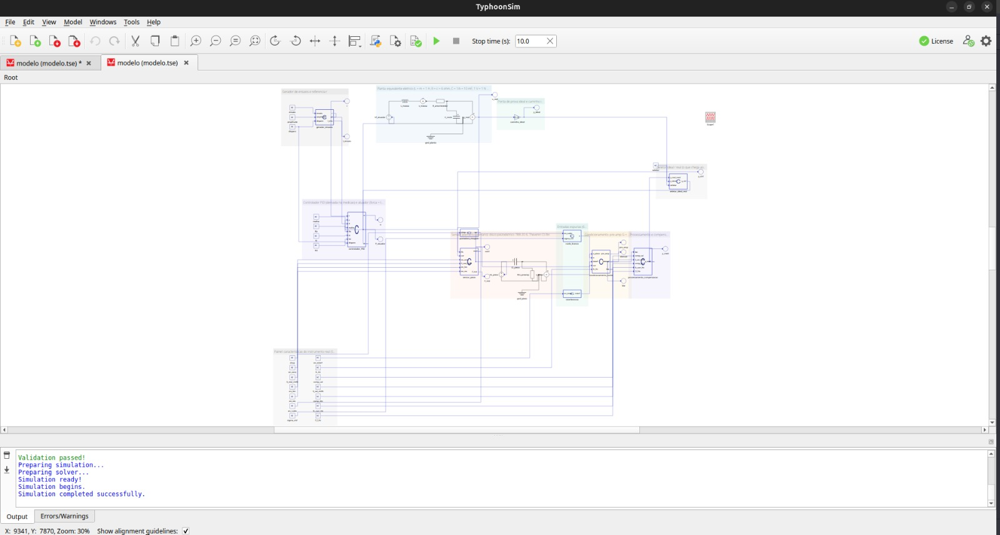
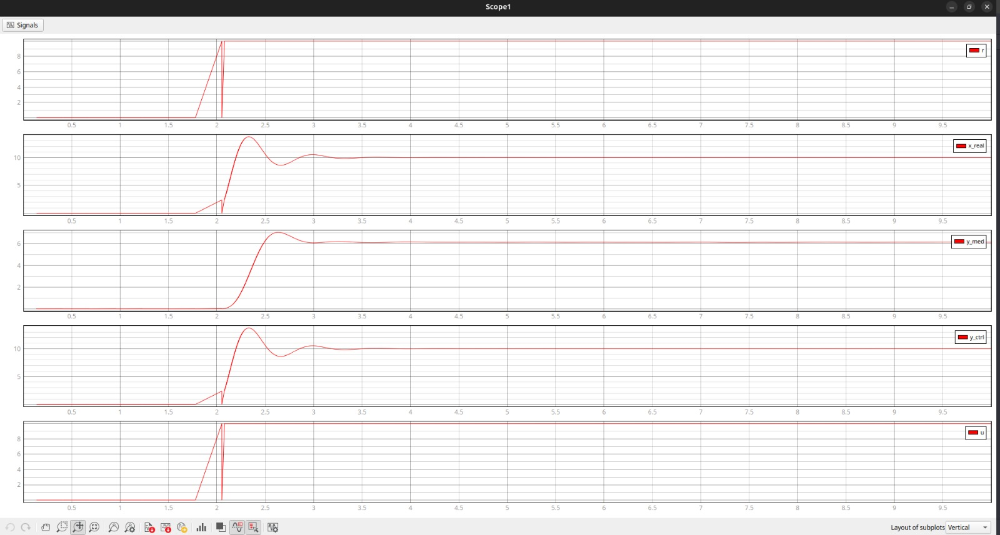

# Instrumentação em malha aberta — instruções do modelo TyphoonSim (roteiro de repetibilidade)

ECOM060 Instrumentação Eletrônica · UFAL · 2026.2 · Grupo 02 (massa-mola-amortecedor) · Fase 2, Entrega 03

O `modelo.tse` traz a planta da Entrega 02 (sem alteração), o caminho ideal (`caminho_ideal`, ganho 1) e o caminho
real (sensor piezo + condicionamento + processamento). O controlador já está no modelo, mas a **Malha** começa em
"aberta": a referência do gerador é a própria força (N). Topologia e valores completos estão em
`../../e4-malha-fechada/typhoonsim/instrucoes.md` (mesmo modelo) e em `codigo/README.md`.

## Valores principais

| Bloco | Valor |
|---|---|
| planta | L = 1 H, R = 6 Ω, C = 10 mF (1 V = 1 N = 1 cm) |
| sensor | S nominal 40 mV/N, real 24,6 mV/N; limiar 0,02 N; resolução 0,01 N; Ct = 10 nF, Rin = 10 MΩ |
| condicionamento | portadora de 100 Hz; G = 5; Butterworth de 2ª ordem, fc = 1 Hz |
| espúrias | ruído σ = 20 mV; offset 3 mV; deriva 5 mV a 0,05 Hz; 60 Hz de 20 mV |
| processamento | K = 1/(S_nom·G) = 5 |

## Roteiro

1. Abrir `modelo.tse` (TyphoonSim 2026.2, VHIL+, passo máximo 1e-4 s), compilar e carregar; abrir `painel.cus`.
2. Malha = aberta; Ensaio = (a); Amplitude = 10 (N).
3. **R4, característica isolada:** pôr em "desligado" sensibilidade, limiar, resolução, ruído e
   offset/deriva/60 Hz; deixar a chopagem ligada. **DISPARAR** e comparar `x_real` (ideal) com `y_med` (real).
   Depois ligar **uma** característica por vez e disparar de novo. Esperado: só o lock-in → atraso de ≈ 0,3 s, erro
   final de 0 %; + sensibilidade → −38,5 %; + ruído/interferências ou + limiar/resolução → sem mudança visível;
   chopagem desligada → leitura volta a zero em ≈ 0,5 s.
4. **R5, exacerbação:** `fc_Hz` = 0,3; `S_real_mVN` = 68,6; `sigma_mV` = 500. Para o 60 Hz de 500 mV, editar
   `A_HUM_I = 0.5` no bloco `interferencia`, recompilar e desligar a chopagem.
5. Os sinais internos (`pre_amp`, `demod`, `bw`) aparecem no terceiro gráfico do painel.

## Capturas de tela

