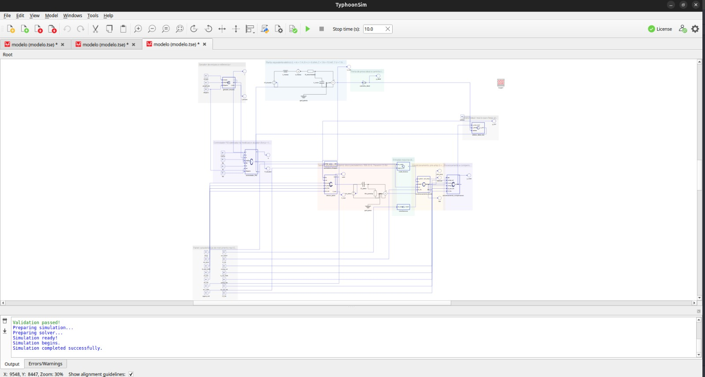
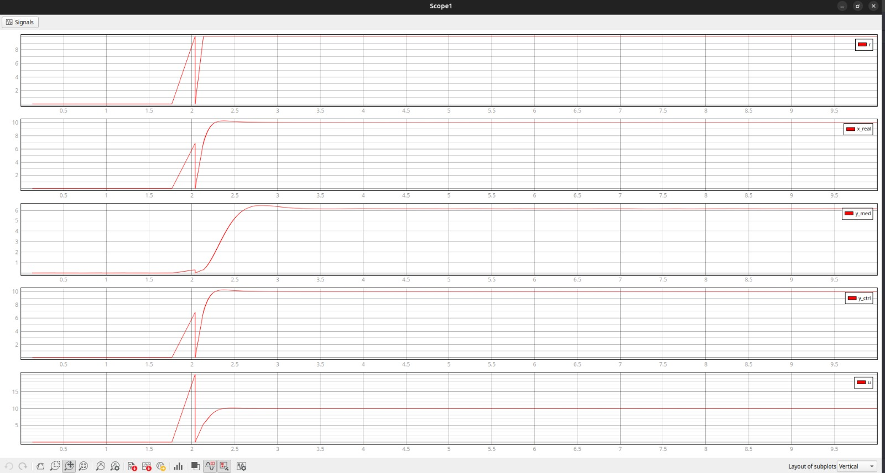
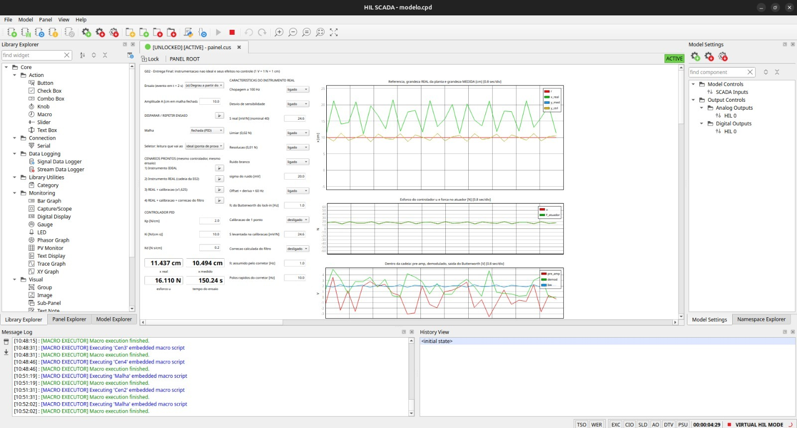

# Sistema instrumentado completo — instruções do modelo TyphoonSim

ECOM060 Instrumentação Eletrônica · UFAL · 2026.2 · Grupo 02 (massa-mola-amortecedor)

Usado na **Entrega 04** (malha fechada) e na **Entrega Final**. Arquivos: `modelo.tse`, `painel.cus` e
`codigo/README.md`, que descreve os blocos C function.

## Topologia

```
gerador_ensaios ─ r ─► controlador_PID ─ F ─► Vf_atuador ─ L_massa ─ v_massa ─ R_amortecedor ─┬─ C_mola ─┐
      ▲ disparo              ▲ y_ctrl                                                        y_real     gnd
      │                      │                                                                  │
      │          seletor_ideal_real ◄── y_ideal ◄── caminho_ideal (ganho 1) ◄────────────────────┤
      │                      ▲                                                                  │
      │                      └── y_med ◄─ processamento_compensacao ◄─ condicionamento_lockin ◄─ v_piezo
      │                                                                   ▲   ▲ n, interf        ▲
      │                                     portadora_chopper ── car ─────┘   │          Vs_piezo─Ct_piezo─Rin_preamp
      │                                                                        │                ▲ vctrl
      │                                     ruido_branco, interferencia ───────┘     sensor_piezo ◄─ y_real, car
```

- **Planta (RLC série):** `L_massa` = m = 1 H, `R_amortecedor` = c = 6 Ω, `C_mola` = 1/k = 10 mF.
  `y_real` = v_C = k·x: **1 V = 1 N na mola = 1 cm**. `v_massa` = corrente = velocidade (1 A = 1 m/s).
- **Caminho ideal:** `caminho_ideal`, ganho 1.
- **Caminho real:** `sensor_piezo` (camada estática) → `Vs_piezo` + `Ct_piezo` (10 nF) sobre `Rin_preamp` (10 MΩ) →
  `v_piezo` → `condicionamento_lockin` (G = 5, demodulação, Butterworth fc) → `processamento_compensacao` (K = 5,
  calibração, correção do filtro) → `y_med`.
- **Seletor:** `seletor_ideal_real` (SCADA `seletor`: 0 ideal, 1 real) → `y_ctrl` → `controlador_PID` →
  `Vf_atuador` (força = tensão).

## Valores

| Parâmetro | Valor | Origem |
|---|---|---|
| m, c, k | 1 kg, 6 N·s/m, 100 N/m | Entrega 01 |
| S nominal / real | 40 mV/N / 24,6 mV/N (SCADA `S_real_mVN`) | APC 850 (d33 ±20 %), Murata 7BB-20-6 (Ct ±30 %) |
| limiar, resolução | 0,02 N, 0,01 N | estimativa da equipe |
| Ct, Rin | 10 nF, 10 MΩ (τ = 0,1 s) | datasheet Murata, entrada do pré-amp |
| portadora | 100 Hz | Fase 1 |
| G do pré-amp | 5 (era 25 na Fase 1, para 0–1 N) | faixa de 20 N → 5,7 V de pico |
| Butterworth | 2ª ordem, fc = 1 Hz (SCADA `fc_Hz`) | Fase 1 |
| ruído | σ = 20 mV (SCADA `sigma_mV`) | estimativa |
| offset, deriva, 60 Hz | 3 mV; 5 mV a 0,05 Hz; 20 mV de pico | TL072; estimativas |
| PID | Kp = 2 N/cm, Ki = 10 N/(cm·s), Kd = 0,2 N·s/cm, Tf = 10 ms, ±60 N | projeto (item 5) |
| corretor | fc assumido 1 Hz (`fc_corr_Hz`), polos rápidos 10 Hz (`f_f_Hz`) | item 8 |
| simulação | VHIL+, método exato, passo máximo 1e-4 s; blocos de sinal a 1e-4 s | — |

## Elementos não lineares

Zona morta (limiar) e quantização (resolução) em `sensor_piezo`; produto (modulação e demodulação); saturação e
anti-windup em `controlador_PID`. O código está em `codigo/README.md` e nos próprios blocos.

## Como executar

1. Abrir `modelo.tse` no TyphoonSim 2026.2. Em *Model Settings*: VHIL+, passo máximo 1e-4 s.
2. *Compile* → *Load to VHIL*. Abrir `painel.cus` no HIL SCADA e iniciar a simulação.
3. Os ensaios começam com o botão **DISPARAR** (evento 2 s depois; os 2 s iniciais preparam o regime).
4. **Cenários prontos** (degrau de 10 cm em malha fechada):
   - **1) Instrumento IDEAL** — item 5: acomodação ≈ 0,45 s, sobressinal ≈ 2,4 %.
   - **2) Instrumento REAL** — item 6: `x_real` oscila (sobressinal ≈ 285 %).
   - **3) REAL + calibração** — instável (só calibrar piora).
   - **4) REAL + calibração + correção do filtro** — item 8: erro ≈ 0 %, acomodação ≈ 0,5 s, sobressinal ≈ 5,6 %.
5. **Item 4 (malha aberta):** Malha = aberta, Seletor = real, Amplitude = 10 (N), todas as características
   desligadas; ligar uma por vez e disparar. Comparar `x_real` com `y_med`.
6. **Item 7 (ruptura):** Seletor = real, características desligadas, Malha = fechada. Digitar `fc_Hz` = 5; 6,5; 7;
   10; 15; 17 e disparar (prever antes!). Depois `fc_Hz` = 10, `Desvio de sensibilidade` ligado e
   `S_real_mVN` = 39,2; 40; 40,8; 41,2 (S/S_nom = 0,98 a 1,03).
7. **Robustez da correção:** cenário 4 e depois `fc_Hz` = 0,9 (corretor em 1,0): volta a oscilar. Com
   `fc_corr_Hz` = 0,85, tolera de 0,9 a 1,3 Hz.

## Resultados esperados

Ver as tabelas do dossiê (itens 4 a 8) e os CSV em `../dados/`. Valores-chave: janela de fc de 7 a 15 Hz sem
correção; janela de S/S_nom de 0,99 a 1,02; com correção, fc real tolerado de 1,0 a 1,5 Hz (corretor em 1 Hz).

## Capturas de tela






