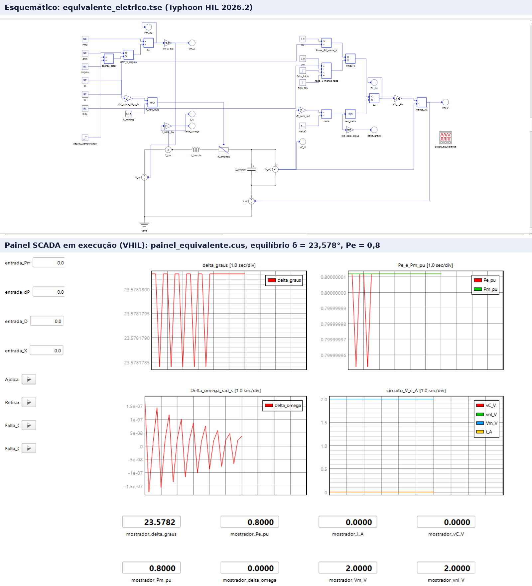

# Fase 2, Entrega 02 (G08): equivalente elétrico, roteiro de repetibilidade (R5)

A planta é a swing equation da E01, (2H/ωs)·δ̈ = Pm − Pmax·sen δ − D·δ̇, que aqui aparece como uma malha única:

    Vm = L di/dt + R i + vC + vnl ,   C dvC/dt = i ,   vnl = KV·Pmax(t)·sen(δ0 + vC/(KV·Ks)) − vC

Escalas: KV = 2,5 V/pu, KI = 0,1 A/(rad/s), tempo 1:1. Elementos: L = 0,66315 H (0,66215 H no Inductor + 1 mH
interno do Variable Resistor), R = 25·D Ω, C = 21,822 mF. Leituras: δ = δ0 + vC/4,5826 (rad), Δω = i/0,1, Pe = (vC + vnl)/2,5.

## Versões e arquivos

| Item | Versão |
|---|---|
| Typhoon HIL Control Center | **2026.2**, modo Virtual HIL (VHIL), dispositivo HIL101. A simulação offline do TyphoonSim exige uma licença que não temos; tudo roda no VHIL |
| Python da API | `C:\Program Files\Typhoon HIL Control Center 2026.2\python3_portable\python.exe` |
| Python (gabarito e comparação) | 3.12, NumPy, pandas, Matplotlib |

Tudo o que é preciso para repetir os ensaios está nesta pasta (`typhoonsim/`):

| Arquivo | Conteúdo |
|---|---|
| `equivalente_eletrico.tse` | modelo (só biblioteca `core`, sem C function) |
| `painel_equivalente.cus` | painel SCADA |
| `monta_modelo.py`, `monta_painel.py` | regeram o `.tse` e o `.cus` a partir de `gabarito/parametros_e02.py` |
| `roda_vhil.py` | roda os ensaios no VHIL e grava `dados/*.csv` (`roda_typhoon.py` faz o mesmo na simulação offline, que exige licença) |
| `dados/` | as 15 capturas do VHIL usadas no relatório (CSV, 1 kHz) |
| `gabarito/parametros_e02.py`, `circuito.py`, `equivalente.py` | escalas, gabarito do circuito em Python, análises R1/R3/R4 |
| `gabarito/compara_typhoon.py` | VHIL × E01: `gabarito/resultados_typhoon.json` e as figuras 2 e 3 do relatório |

O relatório está em `../relatorio/relatorio.pdf`. O gabarito importa o modelo da E01 de
`../../e1-caracterizacao/simulacao/` (entrega já submetida, só leitura).

## Topologia e valores

Malha série única: fonte `V_m` (Signal Controlled Voltage Source, Vm = KV·Pm) → `I_dw` (medição de corrente,
i = KI·Δω) → `L_inercia` (Inductor, 0,66215 H) → `R_amortec` (Variable Resistor, R = KV·D/KI = 25·D Ω, mínimo 1 µΩ,
1 mH interno) → `C_sincron` (Capacitor, 21,822 mF, tensão inicial 0) → `v_nl` (Signal Controlled Voltage Source) → terra.
`V_vC` mede a tensão no capacitor (vC = KV·Ks·(δ − δ0)). Os SCADA Inputs `Pm0`, `dPm`, `degrau`, `D`, `X` e `falta` alimentam
a parte de sinais; a falta faz Pmax(t) = 0 enquanto `falta` = 1. Passo do circuito: 20 µs.

**Elemento não linear:** `Vnl = KV·Pmax(t)·sen(δ0 + vC/(KV·Ks)) − vC`, com KV·Ks = 4,5826 V/rad e Pmax = E′V/X = 2,0 pu
(X = 0,6). O termo −vC tira a parte linear que o capacitor já representa.

## Pela interface (passos numerados)

1. Abra o Control Center e o **Schematic Editor**. Feche abas antigas: compilar uma aba velha sobrescreve o modelo.
   Faça File → Open → `equivalente_eletrico.tse` e clique em **Compile**.
2. Abra o **HIL SCADA** e faça **Load Model** → `equivalente_eletrico Target files/equivalente_eletrico.cpd` (criada pela compilação, ao lado do `.tse`).
   Sem placa, escolha **Load Model to Virtual HIL (VHIL)**. Depois, **Panel → Open Panel** → `painel_equivalente.cus` e **Start**.
   As caixas de texto começam vazias (o modelo usa Pm0 = 0,8, dPm = 0,1, D = 0,01, X = 0,6). Não aperte Enter com a caixa vazia.
   *Esperado:* δ = 23,578°, Pe = 0,8000, Vm = vnl = 2,00 V, vC = 0.
3. **Ensaio (a).** Clique uma vez em "Aplicar degrau" (os botões enviam o valor no clique; não são chaves).
   *Esperado:* 1º pico de 29,70° cerca de 0,38 s depois, período de 0,766 s, acomoda em 26,74° em ~20 s;
   Pe = 0,90; Vm = 2,25 V; **vC = 0,25 V**. "Retirar degrau" e esperar voltar a 23,58°.
4. **D = 0,1** (digite e Enter), depois "Aplicar degrau". *Esperado:* pico de ~28,2° e acomodação em ~2 s, em 26,74°.
   Com 0,441 ou 1,0, sobe sem oscilar.
5. **X = 0,9** + Enter. *Esperado:* novo equilíbrio de 42,45° com o degrau aplicado (vC = 1,51 V), ou 36,87° sem degrau.
   Volte a 0,6. A caixa X não mostra o valor em uso: confira pelo δ.
6. **Falta ON/OFF à mão:** a duração passa sempre do tempo crítico (288 ms), e o gerador perde o sincronismo
   (δ cresce sem limite, Δω → Pm/D = 90 rad/s). Para voltar, Stop e Start (o Stop não zera as entradas SCADA).
7. **Ensaio (b):** Stop; no Schematic Editor, `C_sincron` → *initial voltage* = 2.913; Compile; Start.
   *Esperado:* mínimo de −7,3° e 1º máximo em 0,777 s (54,7°), acomodando em 23,58°. Volte a tensão inicial para 0.
8. **Capturas com duração exata** (faltas de 200/270/287/288/290 ms, D e X): feche o SCADA, deixe o Schematic Editor aberto e rode, na pasta `typhoonsim`,
   ```powershell
   $PY = "C:\Program Files\Typhoon HIL Control Center 2026.2\python3_portable\python.exe"
   & $PY roda_vhil.py                       # ~50 min (o VHIL roda ~8x mais devagar que o tempo real)
   python gabarito\compara_typhoon.py       # Python comum
   ```
   *Esperado:* ganho, tp, Mp e ωd a ≤ 1 % da E01; σ +5 % e ts −5 % (amortecimento extra de ~0,01 1/s do VHIL);
   falta de 200 ms: δmax = 80,6°; 270 ms: 123,6°; tempo crítico entre 288 e 290 ms (E01: 287,9 ms).
   O `roda_vhil.py` termina recompilando o modelo nos valores do painel.

## Por script

```
# na pasta typhoonsim
& $PY monta_modelo.py                # regera o .tse (depois: Open + Compile no Schematic Editor)
& $PY monta_painel.py                # regera o .cus (com o HIL SCADA aberto, senão trava)
& $PY roda_vhil.py                   # capturas no VHIL -> dados/*.csv
python gabarito/compara_typhoon.py   # comparação com a E01 -> figuras 2 e 3 do relatório
```

## O que é o gabarito Python

`gabarito/circuito.py`: `simula_amostrado` resolve a malha R-L-C de forma exata entre amostras (ZOH) e atualiza a fonte
controlada a cada 20 µs, com vC medido no início da amostra, que é o esquema do simulador.
`simula_continuo` (RK4, 1 ms) mostra que as equações são as da E01: a diferença é de 2×10⁻¹⁵ rad.

## Captura de tela (esquemático + painel SCADA)


