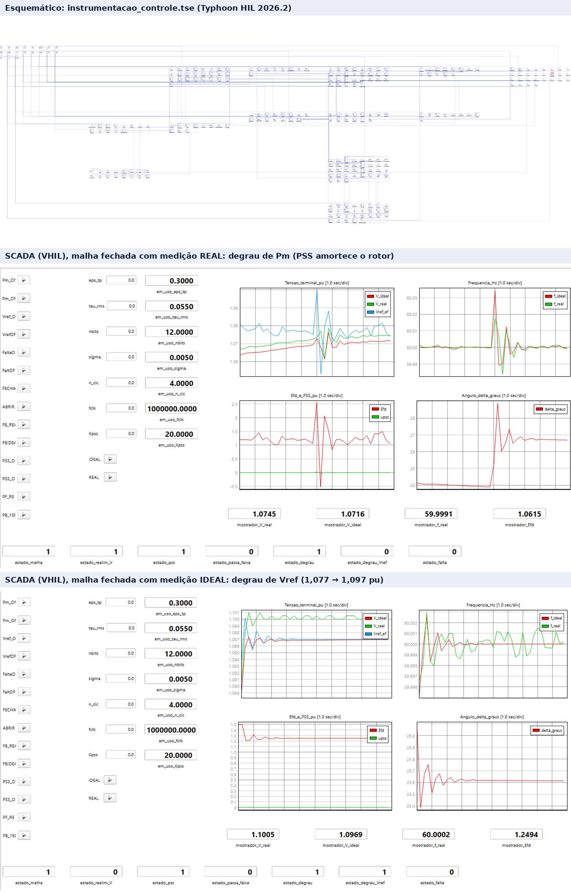

# Fase 2, Entrega 04 (G08): controle em malha fechada, roteiro de repetibilidade (R6)

A E04 fecha a malha de tensão (AVR PI) e de amortecimento (PSS) com a medição projetada na E03 e mede quanto as
características do instrumento real mudam o desempenho. O modelo é o mesmo da E03 (cópia idêntica em
`../../e3-instrumentacao/typhoonsim/`), repetido aqui para a entrega ficar completa.

## Versões e arquivos

| Item | Versão |
|---|---|
| Typhoon HIL Control Center | **2026.2**, modo Virtual HIL (VHIL), dispositivo HIL101; modelo só com a biblioteca `core`, sem C function |
| Python da API | `C:\Program Files\Typhoon HIL Control Center 2026.2\python3_portable\python.exe` (abaixo, `$PY`) |
| Python (gabarito e comparação) | 3.12, NumPy, SciPy, pandas, Matplotlib |

Tudo o que é preciso está nesta pasta (`typhoonsim/`):

| Arquivo | Conteúdo |
|---|---|
| `instrumentacao_controle.tse` | modelo (estado padrão: malha aberta, cadeia real, sem degrau temporizado) |
| `painel_e3e4.cus` | painel SCADA |
| `monta_modelo.py`, `monta_painel.py` | regeram o `.tse` (com o Schematic Editor aberto) e o `.cus` (com o HIL SCADA aberto) |
| `roda_vhil.py` | roda os ensaios `e04_*` no VHIL e grava `dados/*.csv` |
| `dados/` | as capturas do VHIL usadas no relatório (CSV) |
| `gabarito/` | gabarito Python: `parametros_e34.py`, `sistema.py` (transcrição do modelo), `controle.py`, `e04.py` (R1–R5 → figuras e `resultados_e04.json`), `ensaios_e34.py` (tabela dos ensaios), `confere_fiacao.py` (executa a fiação do `.tse` bloco a bloco: diferença ≤ 1e-12), `compara_typhoon.py` (VHIL × gabarito → `comparacao_typhoon.json` e a figura 4 do relatório) |

O relatório está em `../relatorio/relatorio.pdf`. O gabarito lê os parâmetros da E02 em
`../../e2-equivalente-eletrico/typhoonsim/gabarito/` (e, por ela, os da E01).
## Topologia e valores

**Planta (igual à E02):** malha série `V_m` → `I_dw` → `L_inercia` (0,66215 H + 1 mH) → `R_amortec` (25·D Ω) →
`C_sincron` (21,822 mF) → `v_nl` → terra, com KV = 2,5 V/pu, KI = 0,1 A/(rad/s), passo de 20 µs.

**Elementos não lineares:**

- resíduo da swing equation: `v_nl = KV·Pmax(t)·sen(δ0 + vC/(KV·Ks)) − vC`, com δ = δ0 + vC/4,5826;
- tensão terminal (fasor): `Vt∠θt = (X′d·V∠0 + Xe·E′∠δ)/X`, com X′d = Xe = 0,30 pu, X = 0,60 pu; módulo por
  `sqrt`, ângulo por `atan2` (bloco `theta_t`); durante a falta na barra de AT, Vt = XT/(X′d + XT)·E′ = 0,30 pu;
- forma de onda no secundário do TP: `v(t) = √2·Vt·Vsec·(1 + eps_tp)·sen(ωs·t + θt) + ruído`.

**Cadeia de medição real (taxa de 100 µs, blocos nativos):** TP (erro `eps_tp` = 0,3 %) → ruído gaussiano
(`sigma` = 5 mV rms) → conversor RMS AD637 (filtro de 1ª ordem, `tau_rms` = 55 ms) → ADC de 12 bits (`nbits`) →
**V medida**. Em paralelo: pré-filtro (passa-baixas Sallen-Key de 150 Hz, ou passa-faixa 60 ± 5 Hz no R5 da E04) →
comparador de cruzamento por zero → contador de período com relógio `fclk` = 1 MHz → média de `n_cic` = 4 ciclos →
**f medida**. A cadeia **ideal** entrega Vt e ω da planta sem atraso nem erro.

**Controle (só na E04, `malha` = 1):** campo T′d0·dE′/dt = Efd − E′ (T′d0 = 6 s); AVR PI com Kp/Ki = T′d0 (o zero cancela
o polo do campo); PSS (lavagem + dois avanço-atraso) com ganho `Kpss` = 20, alimentado pela frequência (ideal ou medida).
Os valores numéricos estão em `gabarito/parametros_e34.py` e são gravados nos blocos por `monta_modelo.py`.
## Painel SCADA (`painel_e3e4.cus`)

| Botão | O que faz | Botão | O que faz |
|---|---|---|---|
| `Pm ON` / `Pm OFF` | degrau de Pm (+0,1 pu) | `Vref ON` / `VrefOFF` | degrau de Vref (+0,02 pu) |
| `FaltaON` / `FaltOFF` | falta na barra de AT | `FECHAR` / `ABRIR` | malha fechada / aberta |
| `FB REAL` / `FBIDEAL` | realimentação com a medição real / ideal | `PSS ON` / `PSS OFF` | liga / desliga o PSS |
| `PF  R5` / `PB 150` | pré-filtro passa-faixa (ação do R5) / passa-baixas 150 Hz | `IDEAL` / `REAL` | zera / restaura as seis características |

Caixas de texto (0 desliga a característica): `eps_tp` [%], `tau_rms` [s], `nbits`, `sigma` [V rms], `n_cic` [ciclos],
`fclk` [Hz] e `Kpss`. **A caixa começa vazia e não mostra o valor em uso:** o mostrador `em uso` ao lado de cada uma mostra
o valor que o modelo está usando. A linha `estado_*` (embaixo) mostra malha, realimentação, PSS, pré-filtro, degraus e falta
(0/1). Os botões enviam o valor no clique (não são chaves): confira o efeito pela linha de estado. Mostradores: V medida,
V real da planta, f medida e Efd; gráficos de tensão, frequência, Efd/PSS e δ.

## Abrir e rodar (passos 1 e 2, comuns)

1. Abra o Control Center e o **Schematic Editor**. Feche abas antigas (compilar uma aba velha sobrescreve o modelo).
   File → Open → `instrumentacao_controle.tse` → **Compile**.
2. Abra o **HIL SCADA** → **Load Model** → `instrumentacao_controle Target files/instrumentacao_controle.cpd` (criada pela
   compilação) → **Load Model to Virtual HIL (VHIL)**. **Panel → Open Panel** → `painel_e3e4.cus` → **Start**.
   *Esperado (malha aberta, cadeia real):* V real da planta = 1,0770 pu, V medida = 1,0800 pu (+0,3 %, erro do TP),
   f medida = 60,000 Hz, linha de estado `0 1 1 0 0 0 0`.

## Ensaios da E04 pela interface

3. **Malha fechada com a medição ideal.** `FBIDEAL` e depois `FECHAR`; espere acomodar (estado `1 0 1 0 0 0 0`).
   `Vref ON`. *Esperado:* V real 1,0770 → 1,0970 pu, sobressinal de 4,1 %, acomodação (±10 % do degrau) em 0,44 s,
   Efd de pico 3,10 pu. `Vref OFF`, depois `Pm ON`: afundamento de 1,06 % e oscilação do rotor com ζ ≈ 0,15 (some em ~3 s).
4. **Malha fechada com a medição real.** `FB REAL` (com a malha fechada). *Esperado:* a V medida segue a Vref e a V real
   fica 0,31 % abaixo (1,0737 pu com Vref = 1,0770). No degrau de Vref, sobressinal de 10 % e acomodação de 0,61 s;
   Efd ruidoso, σ ≈ 0,12 pu.
5. **R4, uma característica por vez** (confira no `em uso`): `eps_tp` = 0,6 → V real 0,6 % abaixo (reprova o erro de
   0,5 %); `tau_rms` = 0,25 → sobressinal de ~26 %; `n_cic` = 8 → ζ ≈ 0,09; `n_cic` = 16 → ζ ≈ 0,02 (o rotor volta a
   oscilar); `sigma` = 0,01 → σ(Efd) ≈ 0,23 pu. Volte com `REAL`.
6. **R5, ação de projeto.** `PF  R5` (estado do pré-filtro = 1). *Esperado:* σ(Efd) cai para ≈ 0,064 pu (−47 %) e ζ fica
   em ≈ 0,16; todos os critérios passam. `PB 150` volta ao passa-baixas. `PSS OFF` mostra o rotor mal amortecido sem o PSS.
7. **Valores exatos: por script.** Feche o SCADA, deixe o Schematic Editor aberto e rode, na pasta `typhoonsim`:

   ```powershell
   $PY = "C:\Program Files\Typhoon HIL Control Center 2026.2\python3_portable\python.exe"
   & $PY roda_vhil.py                      # 11 ensaios e04_* (ideal, real e R5; ~50 min)
   python gabarito\compara_typhoon.py      # Python comum
   ```

   Ensaios: (r) degrau de Vref, (p) degrau de Pm, (f) falta de 200 ms e regime, para as medições ideal e real; e
   (r), (p) e regime com o passa-faixa (`e04_R5_*`). O script parte do regime de malha fechada (estados iniciais gravados no `.tse`) e termina
   recompilando o estado padrão. *Esperado:* as métricas da tabela VHIL do R3 do relatório (sobressinal, acomodação,
   afundamento, ζ e σ(Efd) iguais ao gabarito dentro da dispersão do ruído).

## Por script

```powershell
# na pasta typhoonsim
& $PY monta_modelo.py                 # regera o .tse (depois: Open + Compile)
& $PY monta_painel.py                 # regera o .cus (com o HIL SCADA aberto)
& $PY roda_vhil.py                    # capturas da E04 -> dados/e04_*.csv
python gabarito/e04.py                # gabarito, figuras 1-3, 5 e 6, resultados_e04.json
python gabarito/compara_typhoon.py    # VHIL x gabarito -> figura 4
```

## Observações sobre o Typhoon HIL 2026.2 (já corrigidas em `monta_modelo.py`)

- *Signal switch*: `in` = entrada 1, `in1` = entrada 2, `in2` = controle.
- *atan2*: calcula `atan2(in, in1)`, então `in` = parte imaginária e `in1` = parte real; θt(0) = 0,2247 rad (12,88°).
- *Clock*: reinicia quando o estado ≥ `reset_at`; com 10 000 passos de 1e-4 o acumulado fica em 0,99999999999991,
  então o reinício é em 1 − Ts/2 (sem isso o passa-faixa dava um pulso a cada 1 s).
- A fonte `V_m` é *Signal Controlled Voltage Source* (a *Voltage Source* com entrada por sinal compilou como 0 V).
- A SCADA API não tem `set_widget_value` (as caixas começam vazias) nem caixa de seleção (por isso, pares de botões).
- O VHIL roda de 8 a 13 vezes mais devagar que o tempo real. A simulação offline (`roda_typhoon.py`) exige licença.
- O `Random Source` não tem semente: nos canais com ruído a comparação com o gabarito é pelo desvio-padrão.

## Captura de tela (esquemático + painel SCADA)


