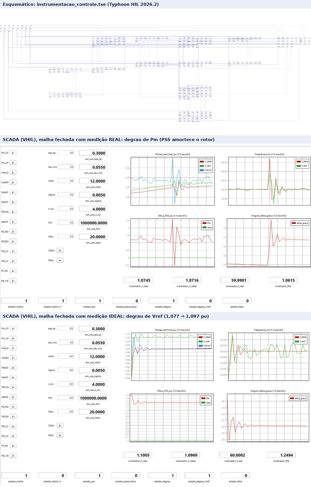

# Fase 2, Entrega Final (G08): modelo, painel e roteiro dos ensaios no TyphoonSim

O modelo é o mesmo da E03/E04 (`instrumentacao_controle.tse`), repetido aqui para a entrega ficar completa. Ele
reproduz a **Figura 1 da orientação**: planta (equivalente elétrico) → ponta de prova ideal → caminho ideal e caminho
real (sensor, condicionamento, processamento) → **seletor ideal/real** → controlador → atuador → planta. Versões,
arquivos e o resumo dos passos dos itens 4, 6 e 7 estão no `../README.md`.

## Topologia e valores

**Planta (E02):** malha série `V_m` → `I_dw` → `L_inercia` (0,66215 H + 1 mH) → `R_amortec` (25·D Ω) → `C_sincron`
(21,822 mF) → `v_nl` → terra. Escalas: K_V = 2,5 V/pu (P_m → V_m), K_I = 0,1 A por rad/s (Δω → i), v_C = 4,583 V/rad·(δ − δ0).
Passo de 20 µs.

**Elementos não lineares:**

- resíduo da swing equation: `v_nl = K_V·Pmax(t)·sen(δ0 + v_C/4,5826) − v_C`, com Pmax = E′·V/X·(1 − falta);
- tensão terminal (fasor, blocos `Vt_mod` e `theta_t`): `Vt∠θt = (X′d·V + Xe·E′∠δ)/X`, X′d = Xe = 0,30 pu; durante a
  falta na barra de AT, Vt = XT/(X′d + XT)·E′ = 0,30 pu;
- forma de onda no secundário do TP: `v(t) = √2·Vt·Vsec·(1 + eps_tp)·cos(ωs·t + θt) + ruído`.

**Ponta de prova ideal:** voltímetro `V_vC` (nó do capacitor: δ) e amperímetro `I_dw` (ramo série: Δω). **Caminho ideal:**
V_ideal = |Vt|, f_ideal = 60 + Δθt/(2π·Ts), sem atraso nem erro.

**Caminho real (100 µs, blocos nativos):** TP 13,8 kV : 115 V com erro `eps_tp` (0,3 %) → divisor 115 V → 2 V →
ruído gaussiano `sigma` (5 mV rms) → conversor RMS AD637 (`tau_rms` = 55 ms) + Sallen-Key 10 Hz → ADC de `nbits` = 12
bits (0 a 4,096 V) → **V medida**. Em paralelo: pré-filtro (passa-baixas 150 Hz, ou passa-faixa 60 ± 5 Hz com PF R5) →
comparador com histerese ±20 mV → contador de período com relógio `fclk` = 1 MHz → média de `n_cic` = 4 ciclos →
**f medida**. Carregamento do TP (25 VA em 100 MVA = 2,5×10⁻⁷ pu): desprezível, não inserido no circuito.

**Seletor:** `realimenta_V` e `realimenta_f` (Signal switch), comandados por FB REAL / FBIDEAL.

**Controle (`malha` = 1):** campo T′d0·dE′/dt = Efd − E′ (T′d0 = 6 s); AVR PI com Kp = 61,1 e Ki = 10,18 s⁻¹ (zero sobre o
polo do campo); PSS (lavagem 3 s + dois avanço-atraso T1 = 0,202 s, T2 = 0,072 s) com `Kpss` = 20, limite ±0,1 pu;
excitatriz com teto de −4,8 a 6 pu. Valores em `gabarito/parametros_e34.py` e `gabarito/controle.py`.

## Painel SCADA (`painel_e3e4.cus`)

| Botão | O que faz | Botão | O que faz |
|---|---|---|---|
| `Pm ON` / `Pm OFF` | degrau de Pm (+0,1 pu) | `Vref ON` / `VrefOFF` | degrau de Vref (+0,02 pu) |
| `FaltaON` / `FaltOFF` | falta na barra de AT | `FECHAR` / `ABRIR` | malha fechada / aberta |
| `FB REAL` / `FBIDEAL` | **seletor**: realimentação com a medição real / ideal | `PSS ON` / `PSS OFF` | liga / desliga o PSS |
| `PF  R5` / `PB 150` | pré-filtro passa-faixa (compensação, item 8) / passa-baixas | `IDEAL` / `REAL` | zera / restaura as seis características |

Caixas de texto (0 desliga a característica): `eps_tp` [%], `tau_rms` [s], `nbits`, `sigma` [V rms], `n_cic` [ciclos],
`fclk` [Hz] e `Kpss`. **A caixa começa vazia e não mostra o valor em uso:** o mostrador `em_uso_*` ao lado mostra o
valor que o modelo está usando. Não aperte Enter com a caixa vazia. A linha `estado_*` mostra malha, realimentação, PSS,
pré-filtro, degraus e falta (0/1).

**Mostradores (atenção aos nomes):** `mostrador_V_ideal` = tensão **real da planta**; `mostrador_V_real` = tensão
**medida** pelo instrumento real; `mostrador_f_real` = frequência medida; `mostrador_Efd` = tensão de campo.

## Abrir e rodar

1. Abra o Control Center e o **Schematic Editor**. Feche abas antigas. File → Open → `instrumentacao_controle.tse` →
   **Compile**.
2. **HIL SCADA** → **Load Model** → `instrumentacao_controle Target files/instrumentacao_controle.cpd` → **Load Model to
   Virtual HIL**. **Panel → Open Panel** → `painel_e3e4.cus` → **Start**.
   *Esperado (malha aberta, cadeia real):* planta 1,0770 pu, medida 1,0800 pu, f medida 60,000 Hz, estado `0 1 1 0 0 0 0`.

O VHIL roda 8 a 13 vezes mais devagar que o tempo real: um degrau leva ≈ 30 s de relógio para acomodar.

## Roteiro por item

**Item 4, malha aberta, uma característica por vez.** **IDEAL** → medida = planta. Depois uma caixa só:
`eps_tp = 0.3` → medida 1,0802 (planta 1,0770). Com `tau_rms = 0.055` e **Pm ON**, a V medida acompanha a real ≈ 50 ms
atrasada; com `n_cic = 4`, a f medida ≈ 64 ms atrasada. **REAL** restaura.

**Item 5, controle com o instrumento ideal.** **FBIDEAL** → **FECHAR**; espere (estado `1 0 1 0 0 0 0`). **Vref ON**:
1,077 → 1,097 pu, sobressinal 4,1 %, acomodação 0,44 s, Efd de pico 3,10 pu. **VrefOFF**, **Pm ON**: afundamento de
1,06 % e o rotor amortece com ζ ≈ 0,15. **Pm OFF**.

**Item 6, o mesmo controle com o instrumento real.** **FB REAL** (malha fechada): a medida segue a Vref (1,0770) e a
planta fica em ≈ 1,0737 (−0,31 %); Efd ruidoso (σ ≈ 0,12 pu). **Vref ON**: medida 1,097, planta 1,094, sobressinal ≈ 10 %.

**Item 7, ponto de ruptura** (sempre voltando com **REAL**): `eps_tp = 0.6` → planta 0,61 % abaixo (reprova);
`tau_rms = 0.25` + **Vref ON** → sobressinal ≈ 26 %; `n_cic = 16` + **Pm ON** → ζ ≈ 0,02, o rotor oscila;
`sigma = 0.01` → σ(Efd) ≈ 0,23 pu.

**Item 8, compensação.** **REAL** → **PF  R5** (estado do pré-filtro = 1): σ(Efd) cai para ≈ 0,064 pu (−47 %) e ζ fica
em ≈ 0,16; todos os critérios passam. **PB 150** volta. **PSS OFF** mostra o rotor mal amortecido sem o PSS.

## Por script

```powershell
$PY = "C:\Program Files\Typhoon HIL Control Center 2026.2\python3_portable\python.exe"
# na pasta typhoonsim (Schematic Editor aberto e HIL SCADA fechado, para os scripts da API)
& $PY monta_modelo.py                         # regera o .tse (depois: Open + Compile)
& $PY monta_painel.py                         # regera o .cus (com o HIL SCADA aberto)
& $PY roda_vhil.py e04_real_r e04_real_p      # capturas -> dados/*.csv (ver gabarito/ensaios_e34.py)
& $PY roda_vhil.py fin_a_so_eps_tp            # item 4 no VHIL: uma caracteristica por vez (6 ensaios fin_a_so_*)
python gabarito/final.py                      # Python comum: itens 3-8, figuras e resultados_final.json (~12 min)
python gabarito/compara_typhoon.py            # VHIL x gabarito: figuras 6 e 10, comparacao_typhoon.json
```

`roda_vhil.py` remonta o modelo com os estados iniciais e os SCADA Inputs de cada ensaio, compila, carrega no VHIL,
captura e, no fim, recompila o estado padrão. Os ensaios estão em `gabarito/ensaios_e34.py`.

## Observações sobre o Typhoon HIL 2026.2 (já tratadas em `monta_modelo.py`)

- *Signal switch*: `in` = entrada 1, `in1` = entrada 2, `in2` = controle.
- *atan2*: calcula `atan2(in, in1)`; `in` = parte imaginária, `in1` = parte real; θt(0) = 0,2247 rad (12,88°).
- *Clock*: reinicia em 1 − Ts/2 (com 10 000 passos de 1e-4 o acumulado fica em 0,99999999999991).
- A fonte `V_m` é *Signal Controlled Voltage Source* (a *Voltage Source* com entrada por sinal compilou como 0 V).
- A SCADA API não tem `set_widget_value` (as caixas começam vazias) nem caixa de seleção (por isso, pares de botões).
- O `Random Source` não tem semente: nos canais com ruído a comparação com o gabarito é estatística.

## Captura de tela (esquemático + painel SCADA)


